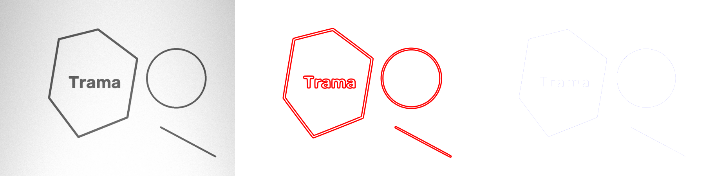
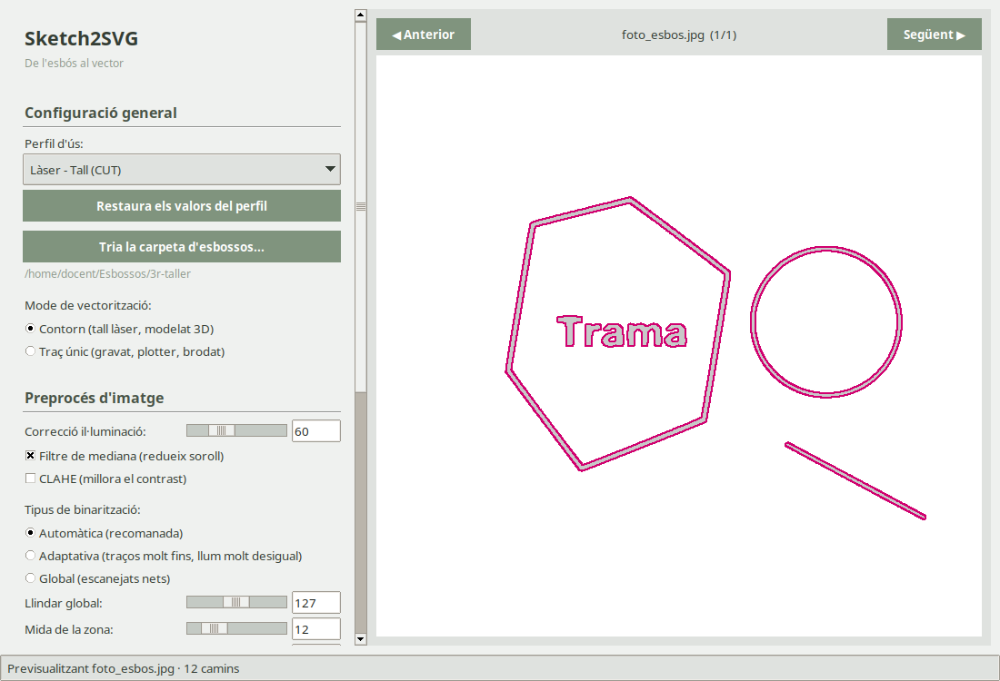

# Sketch2SVG · Trama Maker

[](https://github.com/emaalquadrat/sketch2svg/actions/workflows/tests.yml)
[](LICENSE)

**De l'esbós al vector.** Fes una foto d'un dibuix fet a mà i converteix-lo en un fitxer vectorial (SVG, DXF o CSV) llest per a la talladora làser, el plotter, la brodadora o un programa de modelat 3D.

Pensat per a aules i tallers *maker*: l'alumnat dibuixa en paper, el docent fa la foto i el programa fa la resta. Funciona sense internet.



*D'esquerra a dreta: foto de l'esbós (amb llum desigual), mode **Contorn** (per tallar) i mode **Traç únic** (per gravar o brodar).*

## Què pot fer

| Perfil d'ús | Mode | Fitxers que genera | Per a què |
|---|---|---|---|
| Dibuix / Modelat 3D (Extrusió) | Contorn | SVG | Importar a Fusion 360, Tinkercad, Inkscape… |
| Làser - Tall (CUT) | Contorn | SVG + DXF (capa `CUT`, vermell) | Tallar la silueta del dibuix |
| Làser - Marcat / Gravat (SCORE) | Traç únic | SVG + DXF (capa `SCORE`, blau) | Gravar les línies del dibuix |
| Brodat (Running Stitch) | Traç únic | SVG + CSV de puntades | Brodadores o plotters que llegeixen coordenades |

- **Contorn:** ressegueix les vores de cada traç (amb [potrace](https://potrace.sourceforge.net/)). Dona corbes suaus i formes tancades.
- **Traç únic:** troba la línia central de cada traç, com si es repassés amb un sol bolígraf.
- **Mida real:** tria «Amplada 20 mm», «Alçada 30 mm»… i el fitxer surt directament a aquesta mida, o fes servir els DPI de la foto.
- **Per lots:** converteix tota una carpeta d'esbossos d'un sol cop.



## Com fer-lo servir

1. Fes una foto (o escaneja) cada esbós amb bona llum, ben de cara i sense ombres fortes. Millor traç fosc sobre paper blanc.
2. Posa totes les fotos en una carpeta.
3. Obre Sketch2SVG i prem **Tria la carpeta d'esbossos…**
4. Tria el **perfil d'ús**. Amb les fletxes ◀ ▶ (o les tecles ← →) pots revisar cada imatge.
5. Si cal, ajusta el preprocés (veure consells més avall).
6. Prem **Exporta totes les imatges**. Els fitxers es desen a la subcarpeta `output_vector`.

### Consells si el resultat no és bo

- **Apareixen taques o punts:** puja l'*Àrea mínima* o activa el *Filtre de mediana*.
- **Es perden traços fins o fluixos:** prova la binarització *Adaptativa* o puja el *Contrast*.
- **La foto té ombres:** puja la *Correcció d'il·luminació*.
- **Dibuix clar sobre fons fosc (pissarra):** activa *Inverteix colors*.

## Instal·lació

> Aviat hi haurà versions per descarregar i fer doble clic (Windows i Linux) a la secció [Releases](https://github.com/emaalquadrat/sketch2svg/releases). Mentrestant, cal instal·lar-lo amb Python.

Cal **Python 3.10 o més nou** i el programa **potrace**.

### Linux (Ubuntu, Debian, Linux Mint…)

```bash
sudo apt install python3-venv python3-tk potrace git
git clone https://github.com/emaalquadrat/sketch2svg.git
cd sketch2svg
python3 -m venv .venv
.venv/bin/pip install -r requirements.txt
.venv/bin/python main.py
```

Per tornar-lo a obrir més endavant: `cd sketch2svg` i `.venv/bin/python main.py`.

### Windows

1. Instal·la [Python](https://www.python.org/downloads/) i marca l'opció **«Add python.exe to PATH»**.
2. Descarrega [potrace per a Windows](https://potrace.sourceforge.net/#downloading), descomprimeix-lo i copia `potrace.exe` a la carpeta del programa (o a qualsevol carpeta del PATH).
3. Descarrega aquest projecte (botó verd **Code → Download ZIP**) i descomprimeix-lo.
4. Obre una terminal a la carpeta i executa:

```bat
python -m venv .venv
.venv\Scripts\pip install -r requirements.txt
.venv\Scripts\python main.py
```

> Sense potrace, el mode **Traç únic** funciona igualment; només el mode **Contorn** el necessita.

## Des de la terminal

També es pot fer servir sense finestra, per exemple per automatitzar-lo:

```bash
.venv/bin/python cli.py carpeta_esbossos/ --perfil "Làser - Tall (CUT)" --escala "Amplada 30mm"
```

`python cli.py --help` mostra totes les opcions.

## Per a qui vulgui col·laborar

- `nucli.py`: tot el processament (preprocés, vectorització, exportació), sense interfície.
- `main.py`: la finestra (Tkinter).
- `cli.py`: la versió per a terminal.
- `config_manager.py`: perfils d'ús i configuració desada (a `~/.trama_maker_conversor_2drc.json`).
- `tests/`: proves automàtiques (`pip install pytest` i `pytest`).

Aquest va ser el primer programa d'en Miquel, fet per aprendre Git i GitHub mentre resolia una necessitat real de taller. Si el fas servir a l'aula o el millores, ens agradarà saber-ho: [emaalquadrat.cat](https://emaalquadrat.cat).

## Llicència

[GNU GPL v3 o posterior](LICENSE) (GPL-3.0-or-later). Pots fer-lo servir, estudiar-lo, modificar-lo i compartir-lo lliurement, també en centres educatius. Si en distribueixes una versió, modificada o no, ha de continuar sent lliure: amb el codi font i amb aquesta mateixa llicència.

Copyright © 2025-2026 Ema al quadrat.
